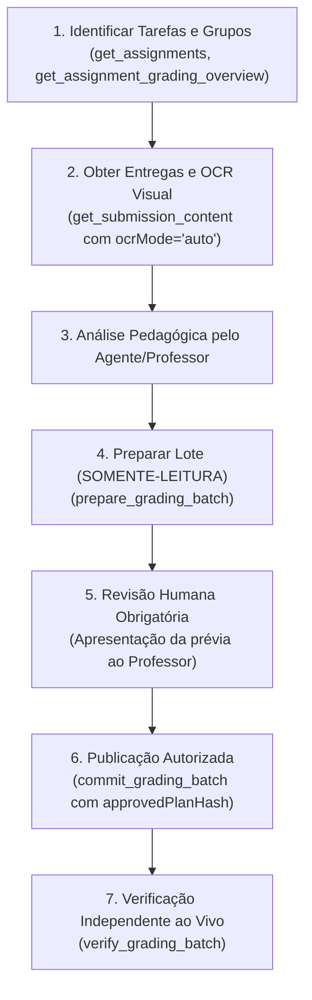

# UFSC Moodle MCP Server (`ufsc-moodle-mcp` v1.2.1)

Servidor **Model Context Protocol (MCP)** em TypeScript desenvolvido para o **Moodle da UFSC** (`https://presencial.moodle.ufsc.br`), com suporte a **Streamable HTTP** (para integração direta com **ChatGPT**, **Codex**, **Claude**, **Orca/Antigravity** e agentes autônomos) e **Stdio**.

## Novidades da Versão 1.2.1

1. **OCR Dinâmico Proporcional com Fallback de Idiomas e `textExtractionComplete`:**
   - **Budget Proporcional ao Documento:** O timeout global de OCR é calculado dinamicamente com base nas páginas elegíveis (`numPagesToOcr * pageTimeoutMs`), garantindo no mínimo 60 segundos por página (ex.: até 120s para 2 páginas escaneadas, até 300s para 5 páginas), sem abortar prematuramente documentos digitalizados densos.
   - **Timeout por Página Configurável (`ocrPageTimeoutMs`):** Parâmetro explícito nas ferramentas `read_moodle_file` e `get_submission_content`, com valor padrão de 60.000 ms e variável de ambiente `MOODLE_OCR_PAGE_TIMEOUT_MS`.
   - **Fallback Controlado de Idiomas:** Se o OCR falhar ou sofrer timeout com o conjunto multi-idioma (ex.: `eng+por`), o servidor executa retry automático utilizando o idioma primário (`eng`) caso ainda reste budget útil (≥ 10s), reutilizando a imagem PNG renderizada sem custo de novo `pdftoppm`.
   - **Sinalização Explícita de Completude (`textExtractionComplete`):** Campo booleano de alto nível que indica se todas as páginas do documento foram lidas com sucesso (seja via texto nativo ou via OCR), permitindo ao cliente distinguir instantaneamente extrações completas de parciais.
   - **Reuso de Arquivos em Disco (`fileId`):** Permite reprocessar arquivos temporários com outros parâmetros de OCR sem refazer o download a partir do Moodle.

2. **Tratamento Otimizado de Avaliações Sem Alterações:**
   - **Detecção Rigorosa de No-Op:** Na ferramenta `prepare_grading_batch`, se os valores propostos (nota e/ou feedback) forem equivalentes aos já registrados no Moodle (ou se um campo for omitido mantendo o valor existente), o plano marca as ações como `preserve` (`gradeAction: 'preserve'`, `feedbackAction: 'preserve'`, `gradeChanged: false`, `feedbackChanged: false`, `anyEffectiveChange: false`).
   - **Status `prepared_no_changes`:** Quando nenhuma alteração efetiva for detectada no lote, `status` é retornado como `"prepared_no_changes"` e `readyToCommit` como `false`.
   - **Commit Protegido sem Escrita (`unchanged_no_action_required`):** Se `commit_grading_batch` for acionado com um plano sem mudanças efetivas, o servidor não executa chamadas Web Service de escrita (`mod_assign_save_grade`), registra a auditoria com `operationStatus: 'unchanged_no_action_required'` e retorna `writesPerformed: 0` de forma segura e idempotente.

3. **Garantia Transparente de Autorização Humana em 4 Níveis:**
   - A resposta de `prepare_grading_batch` expõe a estrutura `humanApprovalRequired.levels`, esclarecendo categoricamente a separação entre:
     - `technicalValidation`: Validação estrutural de tipos, limites e integridade de identificadores.
     - `planIntegrity`: Integridade criptográfica do plano aprovado via `approvedPlanHash` (SHA-256 canônico).
     - `clientConfirmation`: Flag declarada pelo cliente (`confirmedByReviewer: true`) que atesta que o chamador revisou o plano.
     - `humanAuthorization`: Prerrogativa indelegável e exclusiva do docente/professor humano. O agente de IA **não pode se autoautorizar** a publicar notas ou feedbacks.

---

## Funcionalidades Principais da Série 1.2.x

1. **Resolução Definitiva de Grupos de Tarefas Coletivas:**
   - Separa explicitamente agrupamentos gerais de turma (ex.: `62318` - `"INE5458-08208 (20262)"`, que contêm docentes e monitores) dos grupos reais de projeto (`assignmentGroupId`, `assignmentGroupName`, `assignmentGroupMembers`).
   - Nunca inclui professores ou estudantes de outras turmas entre os integrantes da entrega coletiva.
   - Detecta e reporta deterministicamente ambiguidade quando um estudante participa de múltiplos grupos na tarefa (`groupResolutionStatus: 'ambiguous'`, `ambiguousGroupCandidates`), sem escolher silenciosamente o primeiro grupo retornado pelo Moodle.
   - Suporta consulta transparente por `studentId` ou diretamente por `groupId`.
   - Trata o retorno numérico `lastattempt.submissiongroup: 67199` do Moodle 4.1.5+.

2. **Representação Fiel de Avaliações em Grupo:**
   - Separa o estado da linha coletiva com `userid=0` (onde o Moodle reporta `gradingstatus: "notgraded"`) do estado agregado real dos integrantes (`aggregatedGradingStatus: 'fully_graded' | 'partially_graded' | 'not_graded' | 'inconsistent'`).
   - Expõe nota comum (`commonGroupGrade`), alerta de divergência de notas entre integrantes (`hasGradeDivergence`), workflow e visibilidade.

3. **OCR Local Automático no Servidor com Layout Visual Estruturado:**
   - Integra Poppler (`pdftoppm`) e Tesseract (`tesseract`) locais em container Alpine sem envio de documentos acadêmicos para terceiros.
   - Modos: `off` (padrão compatível), `auto` (preserva texto nativo e executa OCR apenas nas páginas escaneadas/sem texto), `force` (OCR em todas as páginas) e `status` (diagnóstico sem execução).
   - Suporta documentos mistos (páginas nativas + páginas escaneadas) sem duplicação de texto.
   - Extrai blocos visuais posicionados (`bbox`, coordenadas normalizadas `normX`/`normY`, região espacial 3x3 na página, ordem de leitura e confiança).
   - Protegido por semáforo de concorrência, clamping de DPI contra canvas bombs, timeouts com `SIGKILL` e limpeza garantida de diretórios temporários `0700`.

4. **Visão Consolidada em Lote (`get_assignment_grading_overview`):**
   - Agrupa em poucas chamadas Web Service todas as informações da turma: grupos, membros, arquivos deduplicados por `fileKey`, notas, comentários de avaliação, workflow, publicação e inconsistências, com paginação (`limit`/`cursor`) e proteção de PII.

5. **Fluxo Auditado e Controlado de Avaliações (`prepare` -> Revisão Docente -> `commit` -> `verify`):**
   - `prepare_grading_batch`: Operação estritamente **somente-leitura**, zero escritas no Moodle. Calcula diff, preserva notas quando apenas feedback é enviado, preserva feedback quando apenas nota é enviada, detecta conflitos e gera `planId` + `planHash` (SHA-256).
   - `commit_grading_batch`: Exige `planId`, `approvedPlanHash`, `confirmedByReviewer: true`, `operationId`, `publicationState` e `notificationPolicy`. Bloqueia `stale_plan_conflict` se houve alteração no Moodle pós-preparação. Grava exclusivamente em `assignfeedbackcomments_editor` (`gradingFeedbackComments`). Idempotência garantida e recuperação de falha parcial com `resumeFailedOnly`.
   - `verify_grading_batch`: Reconsulta o Moodle em tempo real (`fresh: true`) e audita se notas, feedbacks, workflow e visibilidade conferem rigorosamente com o plano aprovado.
   - Trilha de auditoria persistente redigida em JSONL (`MOODLE_GRADING_AUDIT_LOG_PATH`), registrando hashes SHA-256 e sem vazar segredos ou tokens.

6. **Descoberta e Portabilidade MCP (`get_moodle_capabilities`):**
   - Schemas portáveis sem `format: "uri"` (evitando que conectores ChatGPT/OpenAI filtrem parâmetros de URL).
   - Notificações de mudança de ferramentas ativas (`listChanged: true`).
   - Ferramenta de introspecção `get_moodle_capabilities`.

---

## Catálogo Completo de Ferramentas (28 Tools)

| # | Ferramenta | Descrição |
| :- | :--- | :--- |
| 1 | `get_moodle_capabilities` | Metadados do servidor, versão (v1.2.1), suporte a OCR, limites, capacidades e guia de refresh. |
| 2 | `get_site_info` | Dados do usuário autenticado no Moodle (`userid`, nome, `siteurl`, release). |
| 3 | `get_courses` | Lista disciplinas acessíveis com filtro por código/semestre (ex.: `"INE5458"`, `"20262"`). |
| 4 | `get_course_contents` | Lista seções, tópicos, arquivos (PDFs, slides) e módulos da disciplina. |
| 5 | `get_students` | Lista participantes da disciplina com matrícula, papéis e grupos. |
| 6 | `get_assignments` | Lista tarefas da disciplina com enunciado, anexos, datas e flags de workflow/teamsubmission. |
| 7 | `get_submissions` | Lista submissões individuais e coletivas em lote, com notas e grupos resolvidos. |
| 8 | `get_submission_content` | Conteúdo detalhado da entrega por `studentId` ou `groupId`, com OCR automático opcional e layout visual. |
| 9 | `download_moodle_file` | Baixa e preserva os bytes originais do arquivo com URL temporária autenticada por token de capacidade de 256 bits e URI MCP. |
| 10 | `read_moodle_file` | Baixa e extrai texto nativo ou executa OCR local (por `fileurl` ou reusando `fileId` temporário sem novo download). |
| 11 | `get_assignment_grading_overview` | Visão consolidada em lote de entregas, grupos, notas, feedbacks, workflow e inconsistências. |
| 12 | `prepare_grading_batch` | **Somente-leitura.** Valida e prepara plano de avaliação em lote com diff, cálculo de hashes e detecção de conflitos. |
| 13 | `commit_grading_batch` | Publica o plano aprovado pelo professor com concorrência otimista, idempotência e controle de workflow/notificação. |
| 14 | `verify_grading_batch` | Consulta ao vivo o Moodle para auditar notas, feedbacks, workflow e visibilidade pós-publicação. |
| 15 | `provide_feedback` | Avaliação individual pontual segura, preservando campos omitidos (`grade` ou `feedback`). |
| 16 | `get_quizzes` | Lista questionários da disciplina. |
| 17 | `get_quiz_grade` | Consulta notas e tentativas de um aluno em um questionário. |
| 18 | `send_message` | Envia mensagem instantânea direta para um aluno no Moodle. |
| 19 | `get_messages` | Lista mensagens diretas e notificações recebidas/enviadas. |
| 20 | `get_forums` | Lista fóruns da disciplina (*Avisos*, *Dúvidas*). |
| 21 | `get_forum_discussions` | Lista tópicos de um fórum ou lê postagens de uma discussão. |
| 22 | `post_forum_discussion` | Publica aviso/tópico ou responde a postagem em fórum. |
| 23 | `get_course_groups` | Lista grupos da disciplina, participantes, agrupamentos e regras `mod_groupselect`. |
| 24 | `get_group_members` | Consulta participantes confirmados e vagas de um grupo. |
| 25 | `create_course_group` | Cria novo grupo na disciplina (com nome escolhido ou único gerado automaticamente). |
| 26 | `add_group_member` | Adiciona participante(s) a um grupo com validação de matrícula e capacidade. |
| 27 | `remove_group_member` | Remove participante(s) de um grupo de forma idempotente e auditada. |
| 28 | `create_group_with_members` | Operação composta para criar grupo e matricular alunos em uma única chamada. |

---

## Fluxo Recomendado para Avaliação de Trabalhos



---

## Variáveis de Ambiente

| Variável | Padrão | Descrição |
| :--- | :--- | :--- |
| `MOODLE_URL` | `https://presencial.moodle.ufsc.br` | URL base do Moodle da UFSC. |
| `MOODLE_API_TOKEN` | — | Token Web Service estático (`moodle_mobile_app`). |
| `MOODLE_USERNAME` / `MOODLE_PASSWORD` | — | Credenciais CAS UFSC para obtenção dinâmica de token. |
| `PORT` | `8088` | Porta do servidor HTTP MCP. |
| `MCP_AUTH_TOKEN` | — | Token Bearer obrigatório para autenticar clientes MCP. |
| `PUBLIC_BASE_URL` | — | URL pública externa do proxy (ex.: `https://n8n.labsec.ufsc.br/mcp/moodle`). |
| `MOODLE_OCR_ENABLED` | `true` | Habilita o processamento local de OCR. |
| `MOODLE_OCR_LANGUAGES` | `eng,por` | Idiomas padrão do Tesseract. |
| `MOODLE_OCR_MAX_PAGES` | `30` | Limite máximo de páginas por arquivo para OCR. |
| `MOODLE_OCR_DPI` | `200` | Resolução de rasterização Poppler. |
| `MOODLE_OCR_TIMEOUT_MS` | `120000` | Timeout global base de OCR por documento (ajustado dinamicamente pelo número de páginas). |
| `MOODLE_OCR_PAGE_TIMEOUT_MS` | `60000` | Timeout individual de OCR por página renderizada. |
| `MOODLE_OCR_MAX_CONCURRENCY` | `2` | Limite de processos de OCR concorrentes. |
| `MOODLE_GRADING_AUDIT_LOG_PATH` | `/config/grading-audit.jsonl` | Caminho do log JSONL de auditoria de avaliações. |
| `MOODLE_GRADING_STATE_DIR` | `/config/grading-state` | Diretório para persistência de operações em lote. |

---

## Como Atualizar o Catálogo em Clientes MCP (ChatGPT Connectors)

Clientes como o ChatGPT mantêm cache local das ferramentas descobertas via `tools/list`:
1. Acesse **Configurações -> Conectores / Apps -> UFSC Moodle MCP**.
2. Clique em **Atualizar ferramentas** (*Refresh tools*) ou reconecte o conector.
3. Inicie uma **nova conversa** para que o assistente consulte o catálogo v1.2.1 atualizado.

---

## Procedimento de Rollback para a v1.2.0 ou v1.1.0

Caso seja necessário reverter a implantação:
```bash
# No host de produção (n8n.labsec.ufsc.br):
cd /home/labsec/mcp-services
sudo cp -r moodle/code.bak-v1.2.0/* moodle/code/
sudo docker restart mcp-ufsc-moodle-server
```
